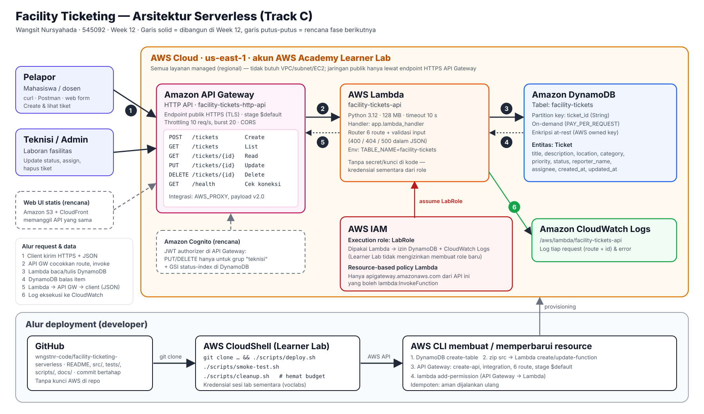

# Facility Ticketing — Serverless di AWS

Sistem tiket untuk melaporkan dan melacak kerusakan fasilitas lab/kampus (proyektor mati, AC bocor, jaringan putus, dan sebagainya).
Pelapor membuat tiket, teknisi memperbarui status sampai selesai.

**Mata kuliah:** Komputasi Awan, proyek individu Week 12 (Design & AWS Setup)
**Mahasiswa:** Wangsit Nursyahada (545092)
**Track:** C, Serverless (Amazon API Gateway + AWS Lambda + Amazon DynamoDB)



## Arsitektur singkat
1. Client mengirim request HTTPS ke **API Gateway HTTP API** (6 route, throttling 10 req/s).
2. API Gateway memanggil **Lambda** `facility-tickets-api` (Python 3.12) lewat integrasi `AWS_PROXY`.
3. Lambda memakai role **LabRole** untuk membaca/menulis tabel **DynamoDB** `facility-tickets` (on-demand).
4. Log setiap request masuk ke **CloudWatch Logs**.

Detail endpoint ada di [docs/api.md](docs/api.md), rencana tahapan di [docs/deployment-plan.md](docs/deployment-plan.md).

## Endpoint CRUD
| Operasi | Method & path |
|---|---|
| Create | `POST /tickets` |
| Read | `GET /tickets`, `GET /tickets/{id}` |
| Update | `PUT /tickets/{id}` |
| Delete | `DELETE /tickets/{id}` |
| Cek koneksi | `GET /health` |

## Struktur repositori
```
src/tickets/app.py      Lambda handler (router + CRUD + validasi)
tests/test_app.py       Unit test dengan DynamoDB tiruan (moto)
scripts/deploy.sh       Membuat/memperbarui DynamoDB, Lambda, API Gateway
scripts/smoke-test.sh   Menguji keempat endpoint CRUD di AWS
scripts/cleanup.sh      Menghapus semua resource (hemat budget)
docs/                   Diagram arsitektur, spesifikasi API, rencana deployment
```

## Menjalankan di AWS Academy Learner Lab
1. **Start Lab**, buka konsol AWS, lalu buka **CloudShell** (region `us-east-1`).
2. Jalankan:
   ```bash
   git clone https://github.com/wngstnr-code/facility-ticketing-serverless.git
   cd facility-ticketing-serverless
   chmod +x scripts/*.sh
   ./scripts/deploy.sh        # mencetak API_URL
   ./scripts/smoke-test.sh    # uji CRUD end-to-end
   ```
3. Setelah selesai: `./scripts/cleanup.sh` (opsional), lalu **End Lab**.

## Uji lokal (tanpa AWS)
```bash
pip install -r requirements-dev.txt
pytest -q
```

## Keamanan
- Tidak ada access key atau `.env` di repositori. Lambda memakai kredensial sementara dari LabRole.
- Hanya API Gateway (API ini) yang boleh memanggil Lambda (resource-based policy).
- Endpoint hanya HTTPS; DynamoDB terenkripsi at-rest.
- Fase berikutnya: autentikasi Amazon Cognito (JWT authorizer) agar `PUT`/`DELETE` hanya untuk teknisi.
